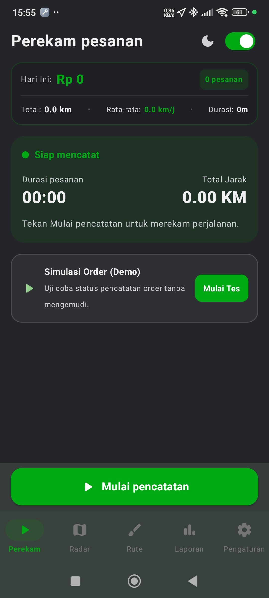
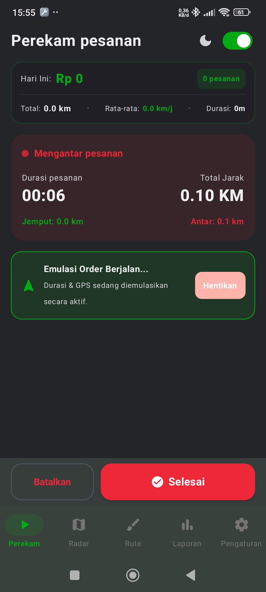
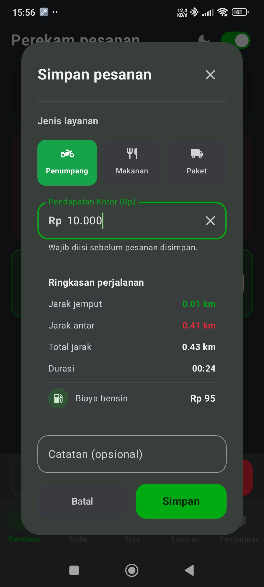
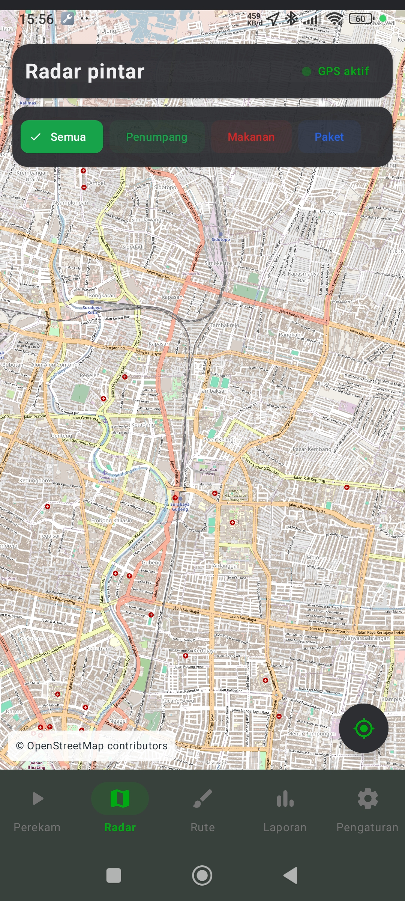
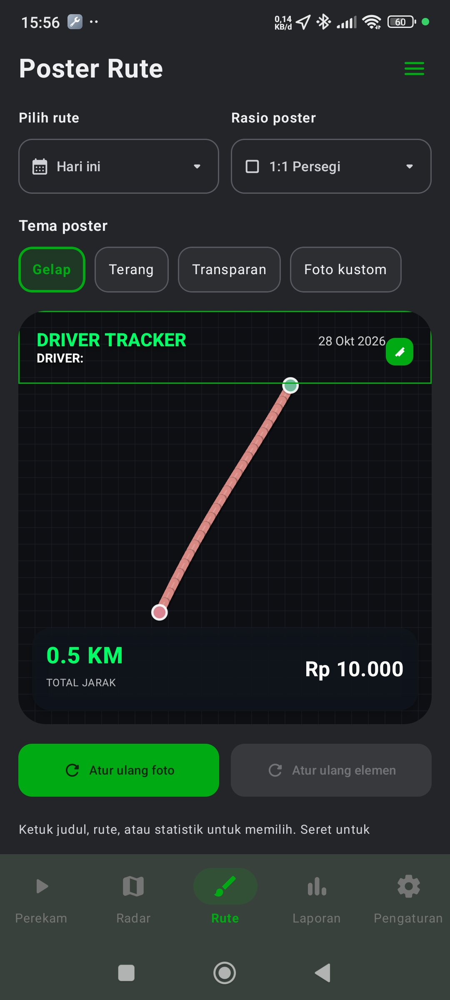
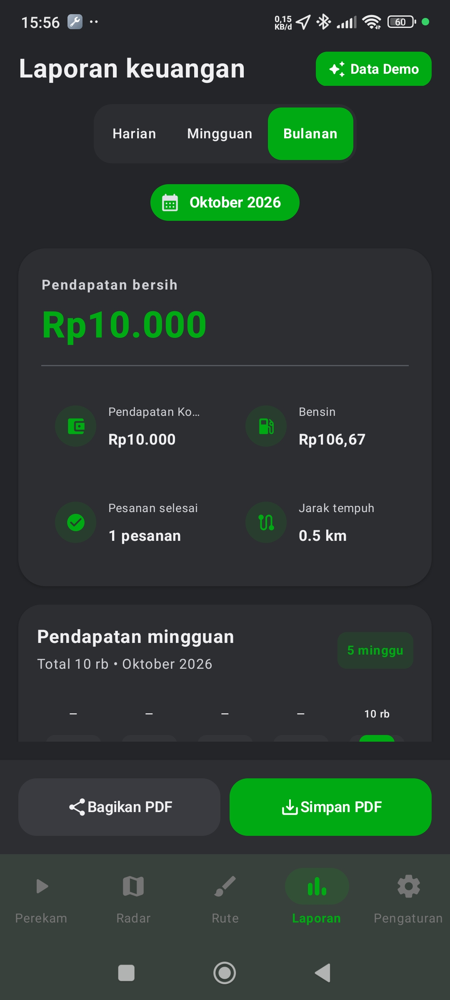
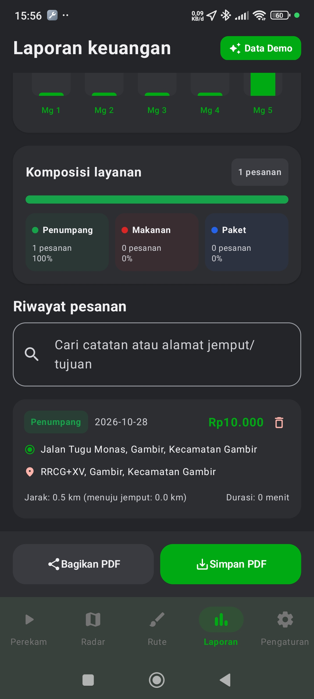
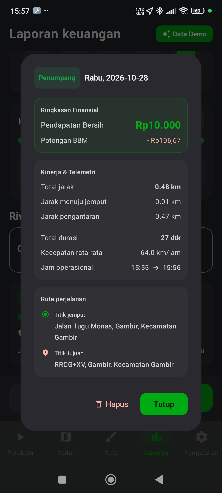
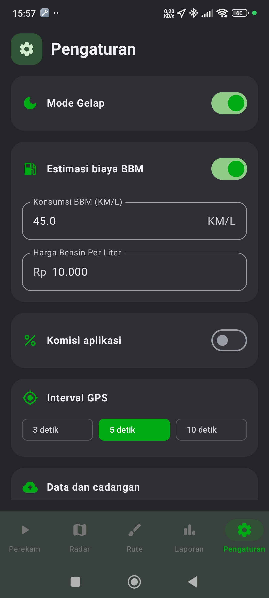

# Driver Tracker

[](https://github.com/okkysatria/DriverTracker/releases/latest/download/Driver-tracker.apk)

Driver Tracker is an Android app for recording driver orders, tracking trips with GPS, reviewing income, and creating shareable route posters. The interface and reports are in Indonesian. Order history is stored locally in a Room database.

## Screenshots

| Perekam — siap | Perekam — order berjalan | Simpan order |
|---|---|---|
|  |  |  |

| Radar | Poster rute | Laporan — ringkasan |
|---|---|---|
|  |  |  |

| Laporan — riwayat | Detail order | Pengaturan |
|---|---|---|
|  |  |  |


## Features

### Order recording

- Record passenger, food, and parcel orders, including income, notes, pickup and destination addresses, and GPS coordinates.
- Track the pickup and delivery legs with GPS points, distance, speed, and elapsed time.
- Keep tracking active in an Android foreground service. Its notification displays trip status and offers start, pickup, complete, and cancel actions.
- Review today's income, completed order count, and distance from the recorder screen.

### Reports and maps

- Filter order history by day, week, or month; search notes and pickup or destination addresses.
- Review net and gross income, estimated fuel expense, trip count, distance, charts, and service-type breakdowns.
- Save or share a PDF income report for the selected reporting period.
- View trip locations and Radar predictions on OpenStreetMap.

### Smart Radar

- Display demand predictions around the driver's current GPS location using a user-imported ONNX model.
- Filter predictions by all services, passengers, food, or parcels. The app evaluates current and next-hour forecasts and shows up to 30 top map results.
- Import and remove the model from Settings. No pretrained model is bundled with the app.

### Route posters

- Create a poster from the current day's live tracking or a selected date's saved trips.
- Choose square (1:1) or story (9:16) dimensions, with dark, light, transparent, and custom-photo backgrounds.
- Customize which route, driver, distance, income, duration, and speed details appear. Move and resize poster groups and style route and text outlines or shadows.
- Save the poster as a PNG in the gallery or share it.

### Settings and data management

- Toggle dark mode; set the GPS sampling interval to 3, 5, or 10 seconds.
- Configure commission and fuel-cost estimation using fuel efficiency and price per liter.
- Set the driver name and poster content and appearance.
- Export order data as JSON backup or CSV, import a JSON backup with duplicate records skipped, or delete the order history.

## Radar model format

The Radar screen accepts an ONNX file with exactly one float tensor input and one float tensor output. The app validates the model before saving it.

- Input shape: `[batch, 5]`; batch may be dynamic (`-1`) or fixed at `1`.
- Input columns: latitude, longitude, ISO weekday (`1` = Monday through `7` = Sunday), hour (`0`–`23`), and service type (`0` = Penumpang, `1` = Makanan, `2` = Paket).
- Output shape: `[batch]` or `[batch, 1]`; each value represents the predicted order count for the corresponding input row.

Predictions depend on the imported model and its training data. The app samples candidate points around the current location and ranks positive predictions; it does not train models.

## Project structure

```text
app/src/main/java/com/example/drivertracker/
├── MainActivity.kt                 Activity and app entry point
├── data/
│   ├── local/                      Room database, order entity, and DAO
│   ├── model/                      GPS point model
│   ├── preferences/                DataStore preferences
│   └── repository/                 Shared in-memory tracking state
├── ml/                             ONNX model import, validation, and inference
├── service/                        Foreground tracking service and notifications
└── ui/
    ├── components/                 Reusable dialogs and map components
    ├── navigation/                 Navigation 3 destinations and bottom bar
    ├── screens/
    │   ├── dashboard/              Reports, charts, order history, and PDF export
    │   ├── radar/                  Smart Radar map and predictions
    │   ├── recorder/               Live order recording
    │   ├── routeposter/            Poster editor and PNG generation
    │   └── settings/               Preferences, data tools, and model import
    ├── MainAppScreen.kt            Main navigation host
    ├── MainViewModel.kt            UI state and app actions
    └── theme/                      Compose colors, typography, and theme
```

The Android manifest, layouts, icons, and other resources are under `app/src/main/res`. Local unit tests are under `app/src/test`; the instrumentation test source is under `app/src/androidTest`.

## Technology and requirements

- Kotlin 2.4.20, Android Gradle Plugin 9.4.1, and Gradle Wrapper 9.6.0
- Jetpack Compose with Material 3, Navigation 3, Lifecycle ViewModel, and Kotlin Coroutines
- Room 2.8.5 for order history and Preferences DataStore for settings
- Google Play services Location for GPS tracking
- osmdroid with OpenStreetMap tiles
- ONNX Runtime for optional local Radar inference
- Android SDK Platform 37; minimum Android version API 27 (Android 8.1)
- JDK 25 for the configured Gradle daemon; Java source and target compatibility are 11
- The Android app currently packages the `arm64-v8a` ABI

Location permission is required for GPS tracking and Radar. Internet access is used for map tiles. The map uses the public OpenStreetMap tile service: keep attribution visible and follow its tile usage policy. Use a tile provider suited to your deployment if you expect substantial traffic.

## Build and test

Build a debug APK:

```bash
./gradlew assembleDebug
```

On Windows, run `gradlew.bat assembleDebug`.

Run local unit tests:

```bash
./gradlew testDebugUnitTest
```

On Windows, run `gradlew.bat testDebugUnitTest`. The debug APK is written to `app/build/outputs/apk/debug/app-debug.apk`.
